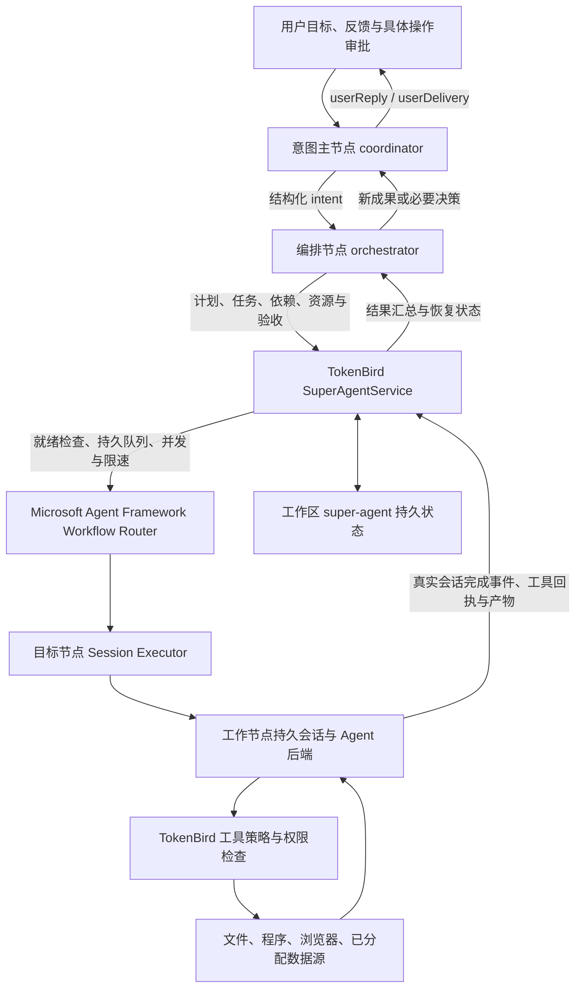

# TokenBird（词元鸟）

TokenBird（中文名：词元鸟）是开源的智能体插件宿主与统一工作台。它在保留现有数据源、页面、会话和工具能力的基础上，提供统一的后端适配层，首批接入 Codex、Pi、Claude Code、Hermes 和 DeepSeek Harness（DSH）；共享用户偏好、工作空间和任务编排。

它把大模型、工具、资料和长期会话放在同一个工作区中，让你可以用自然语言完成研究、写作、编程、资料整理和自动化操作。

每个智能体后端保留自己的推理循环和原生能力。词元鸟通过版本化插件协议补充共享工具、MCP、审批、技能、偏好迁移与会话管理。你可以在桌面应用中管理多个会话，也可以部署到远程服务器，通过 Web、命令行或消息平台使用。TokenNest 提供集成登录、模型发现与账户信息，也可使用其他模型连接。

架构与迁移设计见 [智能体插件迁移方案](docs/agent-plugin-migration.md)，插件协议、Hermes / DSH 接入与偏好迁移见 [接入指南](docs/agent-plugins/README.md)。

[](LICENSE)

## 核心功能

### 多会话工作区

- 用工作区隔离项目文件、来源、技能和凭据。
- 在收件箱中集中管理多个会话，支持标记、归档和自定义状态流转。
- 会话历史持久化保存，可随时继续工作、重命名或分享。
- Agent 回复和工具调用实时流式显示，执行过程清晰可见。

### 多模型与多种登录方式

可按连接或工作区选择模型，并在不同任务之间切换：

- TokenNest（首选，OAuth 安全登录并自动同步模型与余额）。
- Anthropic Claude（API Key，或 Claude Max/Pro OAuth）。
- OpenAI / ChatGPT（含 Codex OAuth）。
- Google AI Studio（Gemini）。
- GitHub Copilot OAuth。
- OpenRouter、Ollama 以及其他兼容 Anthropic 或 OpenAI 协议的自定义端点。

### 连接任意数据源和工具

Agent 可以通过统一的来源（Sources）访问外部服务：

- **MCP 服务器**：支持远程 HTTP/SSE 和本地 stdio 进程，可连接 Craft、GitHub、Linear、Notion 等服务。
- **REST / OpenAPI**：根据 API 文档、端点或 OpenAPI 规范配置自定义接口。
- **本地内容**：访问工作区文件、Git 仓库、Obsidian vault 等本地目录。
- **OAuth 服务**：可配置 Gmail、Calendar、Drive、YouTube、Slack、Microsoft 等集成。

你可以直接告诉 Agent“连接一个来源”，由它读取文档、引导认证并完成配置；已有 MCP JSON 也可以直接导入。

### 技能与可扩展 Agent

- 在工作区保存可复用的技能（Skills）和专属指令，让 Agent 掌握团队流程与领域知识。
- 支持从 Claude Code 导入技能和 MCP 配置。
- 可以用自然语言创建或修改技能，不需要手动维护复杂配置。
- 修改来源或技能后立即生效，无需重启应用。

### 安全可控的执行权限

每个会话都可以选择执行模式：

| 模式 | 说明 |
| --- | --- |
| 探索 | 只读模式，禁止写文件和其他修改操作 |
| 请求确认 | 执行修改前询问用户（默认） |
| 自动 | 自动批准操作，适合受信任的环境 |

权限规则可按工具和工作区定制。凭据使用加密存储，工作区之间相互隔离。

### 文件、文档和浏览器工具

- 拖放图片、PDF、Office 文档等附件，自动提取或转换内容。
- 支持 Markdown、代码高亮、数学公式、表格和差异对比。
- 提供多文件 diff 窗口，集中查看 Agent 在一轮对话中的所有改动。
- Agent 可在受控浏览器窗口中打开网页、操作页面、查看网络请求，并将浏览器作为工作流的一部分。

### 自动化与后台任务

- 长时间任务在后台运行，显示进度并可随时取消。
- 根据标签变化、定时计划、工具调用等事件自动创建会话或触发 Agent。
- 适合定期汇总、同步资料、监控项目和批量处理等场景。

### 多种运行方式

同一套 Agent 能力可通过不同入口使用：

- **Electron 桌面端**：功能完整的图形界面，适合日常工作。
- **Web UI**：连接无头服务器，在浏览器中访问会话。
- **无头服务器**：部署在 VPS、局域网或 Docker 中，保持会话长期运行。
- **CLI 客户端**：通过 WebSocket 操作工作区和会话，支持脚本、CI/CD 及流式输出。
- **消息网关**：可将 Agent 接入 Telegram、WhatsApp 等消息渠道（具体渠道取决于部署配置）。
- **会话分享与查看器**：将会话记录上传并以只读网页分享。

## 超级智能体：运行架构与规则

以下对应 **2026-10-12 当前仓库源码**。超级智能体按工作区保存团队、目标和执行状态，通过已有模型连接运行多个持久节点会话。实际安装版本的行为以其构建源码为准。配置入口与操作说明见 [超级智能体使用指南](docs/super-agent.md)，专项设计见 [设计文档目录](docs/super-agent/README.md)。

### 1. 运行分层与执行路径



| 层级 | 当前职责 |
| --- | --- |
| 桌面 / Web 客户端 | 展示主聊天、任务进展、节点活动、共享板、产物、审批和设置；向执行宿主提交操作 |
| `SuperAgentService` | 管理角色、目标版本、任务契约、依赖、资源互斥、队列、通信预算、验收、脚本结果与恢复 |
| Microsoft Agent Framework | 固定使用 Python `agent-framework-core==1.21.0`，通过 Workflow / Executor 路由到已有节点会话，并输出工作流事件 |
| 节点 Agent 后端 | 使用 Pi、Claude Code、Codex 或兼容插件自己的推理与工具循环；认证和模型传输来自现有连接 |
| 工具执行层 | 核验角色、调用参数、数据源、目录及容器边界，处理一次性审批，登记操作并执行工具 |
| 持久化层 | 保存配置、目标、计划、任务、检查点、产物指纹、操作状态、排队轮次与恢复身份 |

执行宿主需要 Python 3.10+ 及上述固定依赖；云中继只负责转发，不运行团队。每个宿主懒启动并复用一个 Python 桥接进程，每轮建立独立工作流实例。Executor 使用 `request_info` 请求宿主运行会话，再由宿主回传结果恢复工作流；每轮只允许一次目标会话请求。SDK 的工作流结束事件不代替 TokenBird 的会话完成与任务结算。安装方法见 [Microsoft Agent Framework 运行时](docs/super-agent/microsoft-agent-framework.md)。

### 2. 团队角色与会话边界

新团队包含一个意图主节点、一个编排节点和至少一个工作节点，最多 32 个节点。兼容旧团队缺少编排节点时，在空闲状态补充独立编排节点，并保留原有节点绑定。

| 角色 | 允许的工作 | 宿主限制 |
| --- | --- | --- |
| 意图主节点 `coordinator` | 理解需求，提出必要澄清，通过 `intent` 交接目标，接收编排结果，用 `userReply` / `userDelivery` 回复用户 | 分离编排后只能向编排节点发消息；不能派发工作任务、维护计划和共享板，不能执行文件、程序、浏览器或外部数据源工具 |
| 编排节点 `orchestrator` | 拆解已授权目标，维护计划，选择工作节点，管理依赖、资源、技能和数据源绑定，依据证据验收 | 不能执行工作节点工具；不能用 `userReply` 直接回复用户，用户沟通须交意图主节点 |
| 工作节点 `worker` | 执行已分配任务、研究分析、生成文件、运行允许的工具、独立验证、保存检查点及产物、通信和写共享板 | 不能创建团队任务、维护计划、验收团队任务或直接回复用户；不能派生子智能体或调用额外模型工具 |

- 每个节点复用自己的持久模型会话，节点内串行，不同节点可并行；队内消息复用已有节点。
- 模型、连接、后端、思考强度或资源绑定变化会影响会话身份；旧会话保留为历史和回执证据。职责文字修改通常沿用会话，技能内容在下一轮刷新。
- 可见输入保存上游的原始任务或消息；职责、权限、当前目标、依赖、共享板摘要、资源目录、框架能力、通信预算和恢复说明进入隐藏系统提示词或每轮上下文。
- 编排按实际职责、Skills、工具权限、能力标签和负载选人；框架名称、模型评级不构成能力、费用或完成时间保证。
- 后端的原生 / 兼容路径及已启用能力不同。受控节点通过宿主分配工具与 Skills，不能依靠后端原生扩展增加权限。详见 [框架特色与实际接入](docs/agent-plugins/framework-capabilities.md)。

### 3. 目标、计划与任务契约

| 对象 | 关键字段与规则 |
| --- | --- |
| 目标 `intent` | `goal`、`constraints`、`deliverables`、`acceptanceCriteria`；具有稳定 ID 和修订号。更新已有目标使用 `id` 与 `expectedRevision` |
| 计划 `plan` | `goalId`、`title`、`instructions`、`status`、`priority`、`note` 与 `expectedRevision`；状态为 `planned / active / blocked / completed / cancelled` |
| 任务 `task` | `id`、`nodeId`、`planId`、`goalId`、`goalCriteria`、`instructions`，可声明 `dependsOn`、`resources`、`requiredCapabilities`、`acceptanceCriteria`、`requiresIndependentReview`、`reviewOf`、`thinkingLevel` |
| 验收 `acceptance` | `taskId`、`evidenceTaskId`、`status`、`note`；提交结果与验收分开记录，验收可为 `accepted / rejected / stale` |
| 产物 `artifact` | 工作节点登记文件 ID、路径、说明和所属任务，宿主计算真实 SHA-256；验证任务绑定实际输入版本 |

1. 任务只能分配给已有工作节点。未指定 `nodeId` 时，宿主按能力标签、健康状态、忙闲、队列与启动时间下限选择；专业任务应显式指定负责人。
2. 相同阶段可使用同一 `planId` 分配多个任务。直接创建而没有计划的任务，宿主为其补充持久计划。
3. 依赖必须引用已经存在的任务；同一动作块可先创建前置任务，再按拓扑顺序创建下游任务。已有稳定任务 ID 不能重复提交。
4. 普通依赖要求前置任务 `completed`、控制动作成功且没有拒绝或失效验收；前置任务声明验收条件或独立复核时，还必须已经 `accepted`。
5. 产物审核任务使用 `reviewOf` 指向原任务，**同时把原任务 ID 放入 `dependsOn`，并分配另一工作节点**。它等待原任务提交结果，无需等待原任务先通过其自身审核。
6. `workflow.independentReview` 开启时，所有非 `reviewOf` 的产出任务必须填写非空 `acceptanceCriteria`，宿主强制要求独立复核；团队至少需要两个工作节点。仅在 `instructions` 写验收要求不能替代该字段。
7. `resources` 声明修改路径或外部资源名。路径规范化后，相同资源及父子路径互斥；运行任务、准备中的节点、未结操作或未确认脚本仍会占用资源。只读核验避免声明无关写资源。
8. 指定 `requiredCapabilities` 时，负责人必须具备全部标签。固定思考模式不允许任务更换强度；任务模式可使用 `off / low / medium / high / xhigh / max`。
9. `goalCriteria` 是**任务**覆盖目标验收条件的零基索引，不能写入计划对象。用户改变目标后，旧验收失效，编排须更新计划契约再派工、续做或验收。
10. 计划完成要求所有关联任务完成且已验收，关联脚本停止或结算并交接结果。所有关联计划属于当前目标版本且完成、已验收任务覆盖每项目标条件后，目标才成为 `delivered`。

### 4. 协作 Skill、工具与回执

节点通过注册的会话工具发起协作，参数 Schema 随工具提供。内置 [super-agent-collaboration Skill](apps/electron/resources/skills/super-agent-collaboration/SKILL.md) 说明角色分工、派工、版本更新、证据验收和恢复流程；新团队默认绑定，已有团队在运行时同样加载。模型不再需要在正文拼接动作标签与 JSON。

| 工具 | 使用者与作用 |
| --- | --- |
| `super_agent_intent` | 意图主节点创建或更新用户目标，并交接给编排节点 |
| `super_agent_deliver` | 意图主节点提交答复及可选阶段/最终交付，成功结束本轮后发布 |
| `super_agent_plan` | 编排节点创建或替换一个计划，携带 `expectedRevision` |
| `super_agent_dispatch` | 编排节点派发一个有明确范围与完成条件的工作任务 |
| `super_agent_accept` | 编排节点依据已完成的证据任务记录验收或拒绝 |
| `super_agent_message` | 按角色边界向已有节点投递一条队内消息 |
| `super_agent_board` | 编排或工作节点按修订号保存一个共享条目 |
| `super_agent_resources` | 编排给空闲工作节点分发资源；工作节点可为自己激活资源后结束本轮，由宿主续做 |
| `super_agent_script` | 工作节点登记或运行自己的脚本，运行仍受环境和审批规则约束 |

工具调用沿用真实宿主校验与执行器。节点身份取自当前会话，模型不能指定另一个执行身份；未知字段、非法目标、越权、过期版本和不符合验收契约的调用会被拒绝。每轮总计最多八个协作动作、四个派工任务，通信预算仍生效。

每次调用携带本轮唯一 `requestId`。同 ID、同参数重试返回持久回执，不重复执行；改变参数需使用新 ID。参数错误和版本冲突通过工具结果反馈，模型在当前轮次纠正失败调用。已提交动作在后续模型失败、重试或中断后仍保留，不能重放。回执含实际目标 ID，正文中的“已派发”“已写入”不构成执行证据。

典型流程：意图节点提交目标 → 编排调用 `super_agent_plan` → 用 `super_agent_dispatch` 派发产出任务 → 向另一工作节点派发 `reviewOf` 且带 `dependsOn` 的复核任务 → 证据完成后调用 `super_agent_accept` → 意图节点用 `super_agent_deliver` 交付。独立任务可以并行，相关调用依赖前一个工具的实际结果；这些调用不构成一起回滚的事务。

共享板和计划的新建 `expectedRevision=0`，更新使用原 ID 与最新 revision；替换前读取完整内容并保留有效信息。计划必填 `note`（可为空字符串），可选 `blocker` 缺省时省略。未知操作先安排独立核验及 `reconcile` 跟进，再重试验收。

`super_agent_task` 与 `super_agent_library` 继续负责检查点、等待、产物、操作核验、记忆与归档。直接用户请求可用普通最终正文答复；内部回传使用交付工具显式选择用户可见内容，无变化时保持静默。

历史会话的 `<super_agent_actions>` 仍按原严格规则解析，保留 `applied`、`rejected`、`partially_applied` 和 `notAttempted` 回执。新提示词不要求生成动作块；同一轮不能混用新工具与旧块，以免重复提交已执行的动作。

### 5. 调度、并发、通信与固定限额

- 派工前核对目标版本、计划阻碍、依赖、资源占用、节点状态、节点速率、连接额度和团队任务并发上限。
- `maxCallsPerMinute` 是每节点启动模型轮次的速率，范围 0.1～60；同一节点两轮之间还要满足启动间隔。
- 同一模型连接的并发与每分钟启动数，在同一执行服务已加载的工作区之间累计；它不是供应商所有内部 HTTP 请求的统计。
- 未启动且相容的编排结果汇总可以合并；队内相同消息和纯收件确认会被抑制，避免互相确认形成循环。
- `mcp__session__send_agent_message` 使用团队 `runtime` 中的会话地址。尚无目标会话时，最终动作的 `messages` 可直接引用节点 ID。消息排队成功不表示已读取或完成。
- 完成事件负责结算任务；取消后的晚到事件不能重新激活任务。准备 SDK 或环境时节点为 `preparing`，不把冷启动误认为执行丢失。

| 参数或容量 | 当前限制 / 默认 |
| --- | --- |
| 团队节点数 | 最多 32；新团队至少意图、编排、工作三个节点 |
| 单节点并发 | 1 轮 |
| 工作任务并发 `workflow.maxParallelTasks` | 可配 1～30；预设值见下表 |
| 每连接并发 / 每分钟启动数 | 新配置默认 4 / 60，可配 1～30 / 1～600；旧配置无 `execution` 时兼容上限为 30 / 600 |
| 通信链深度 / 总启动轮次 | 每条链最多 6 跳 / 32 轮，分别检查；隐藏上下文提供剩余额度 |
| 每轮控制动作 | 最多 8 项（意图、验收、计划、板、资源、任务、消息和脚本操作合计） |
| 动作块数组 | `tasks`、`acceptances`、`activateResources`、脚本登记和运行各最多 4 项；计划、共享板和消息各最多 8 项，同时受合计 8 项限制 |
| 轮次队列 / 任务历史 / 目标历史 | 最多 200 / 500 / 100；历史满时需归档清理 |
| 计划 / 共享板 | 各最多 256 条 |
| 单文件产物 | 普通文件，最多 64 MiB |
| 节点技能指令总长 | 最多 128,000 字符（错误提示称 128 KB） |
| 无进展提醒 / 同阶段自动续做 | 默认 15 分钟 / 最多 3 次，可配置 |
| 空闲自检间隔 | 可配 1～1440 整数分钟 |

持续工作允许编排在已有 `planned / active` 计划中，为后续任务阶段开启新通信链；**节点之间的普通消息和脚本运行仍保留原链上限**。因此“持续工作开启”不表示任何消息都可以无限续接。链耗尽时消息会被拒绝，恢复流程另行检查原有证据与队列，不能简单重放整个动作块。

| 预设 | 节点数 | 任务并发 | 独立复核 | 持续工作 | 空闲自检 |
| --- | --- | --- | --- | --- | --- |
| 日常助手 | 5 | 2 | 关闭 | 开启 | 60 分钟 |
| 自主代码 | 7 | 3 | 开启 | 开启 | 10 分钟 |
| 自主科研 | 7 | 4 | 开启 | 开启 | 30 分钟 |
| 高效工作 | 7 | 3 | 关闭 | 开启 | 15 分钟 |
| 故障运维 | 7 | 2 | 开启 | 关闭 | 10 分钟 |

预设只提供初始职责、技能、流程与额度，后续按真实配置执行。默认 Skills 及岗位分工见 [节点技能说明](docs/super-agent/default-skills.md)。

### 6. 共享板、技能、数据源与交付

- 共享板保存跨节点交接契约、结论状态、检查点索引和产物证据；长报告及原始日志保存在文件中。它不能代替任务队列，也不能授予权限。
- `collaboration_board {"action":"get"}` 可读取完整条目、修订号和团队会话地址，并按目标、任务或条目筛选。隐藏上下文中的摘要可能截断，未出现的条目不代表不存在。
- 模型通过最终动作块写板，新建 `expectedRevision: 0`，更新使用最新 `revision`；更新替换整个条目。冲突时先重新读取并合并，不能猜版本或用新 ID 绕过。超级智能体会话不能使用该工具的 `set`。
- Skills 从内置、全局、工作区及项目目录按绑定 slug 加载；缺失技能会阻止轮次。技能中的 `requiredSources`、原生工具描述或职责文本不会增加权限。
- 团队先授权数据源池，节点只能绑定池内且可用的源；凭据继续由现有来源系统管理，不复制到团队配置。`activateResources` 不安装第三方执行程序，不启用未经授权的数据源。
- 工作节点自行激活资源时必须提交单个独立动作，宿主在后续轮次加载资源并继续原任务；未知操作或耗尽预算等状态会阻止该续接。
- 主聊天只显示用户输入、明确选择的答复、交付、审批与必要错误。后台思考、例行自检和内部接力保存在节点活动或历史中。
- `userDelivery` 的 `kind` 为 `stage / final`，必须同时提供非空 `userReply`，可引用最多 16 个已登记且当前可用的产物。宿主保存交付版本；显示“最终交付”本身不更改验收状态。

### 7. 执行环境与权限规则

| 环境 | 实际执行位置与隔离 |
| --- | --- |
| 文件夹 `folder` | 文件工具和程序在执行宿主运行。工作目录不构成操作系统沙箱；不能与 TokenBird 配置、凭据或协调数据目录重叠 |
| Docker / Podman `sandbox` | 命令在节点容器 `/workspace` 执行，文件工具使用对应宿主目录。仅挂载所选目录；只读容器系统、禁网、移除 capabilities、禁止新增权限，并限制 CPU、内存与进程数 |
| 虚拟机 `vm` | 连接已在虚拟机中运行且设置 `TOKENBIRD_EXECUTION_HOST=vm` 的执行服务；当前功能不创建或启动虚拟机 |

**完全控制 `fullControl` 默认开启，是工作节点的审批总开关。**开启后跳过人工审批、Action Gates 和独立 Auto-review，文件工具可访问工作目录内外的宿主路径，宿主程序无需另建容器。意图与编排节点的执行禁止、已分配源边界、自定义 `deny` 规则和真实容器隔离继续生效；完全控制也不会关闭操作记录、去重、资源互斥或验收。

关闭完全控制后的规则如下：

- 授权范围内的文件读取、宿主明确认可的浏览器检索和经过完整语法验证的只读系统查询，可按策略自主执行。
- 文件写入、目录外访问、额外文件能力、浏览器点击或填写、外部发送、消费、部署以及未知副作用，需要具体调用的一次性批准；来源工具的名称或 MCP `readOnlyHint` 不足以自动放行。
- 宿主通用命令按真实调用申请审批；沙箱只读查询是否放行取决于已验证的命令合同。模型必须使用工具实际支持的 Shell 语法，不能因宿主是 Windows 就把 PowerShell 命令交给 Bash。
- 审批绑定调用 ID、完整参数、具体路径、执行环境和策略版本，最长 10 分钟且只能使用一次；换参数、换策略、取消、过期和重启使旧许可失效。历史“共享授权”不能批准新的行动门。
- `autoReview` 可选、默认关闭。启用时通过独立、无工具上下文判断 `consistent / needs-human / deny`，消耗模型额度；`consistent` 仍需人工批准，拒绝阻止当前调用，超时或非法输出交人工处理。
- 自定义规则只支持 `deny / require-human`，不能扩权。审批不能放行未分配数据源、派生节点、额外模型调用或真实容器限制。

受控后端禁用或隔离未经宿主管理的扩展发现。Codex 在符合连接条件时保留原生 app-server 推理循环，执行工具由 TokenBird 动态提供；其原生线程恢复不支持当前动态工具时，创建新线程并恢复可见历史，不能宣称恢复全部原生隐藏状态。完整权限与后端边界见 [行动门设计](docs/super-agent/action-gates.md)和[框架能力](docs/agent-plugins/framework-capabilities.md)。

### 8. 检查点、操作记录与未知结果核验

- 工作节点用 `super_agent_task` 的 `checkpoint` 保存已完成步骤、下一步、备注及修订号；不能删除已完成步骤，重复内容或只改备注不视为阶段推进。
- `wait` 可等待时间、共享板版本、任务依赖或目录内文件存在 / 内容变更。开启持续工作时，宿主约每 5 秒检查条件，满足后续做原任务，避免用模型轮询。
- 可能产生副作用的工具在执行前持久登记操作：`prepared → running → completed`。错误、中断或缺失确定回执可能成为 `unknown`；同一任务、阶段、工具和参数的重复调用会被拦截。
- `completed` 的操作记录只证明调用结算；已识别为正常终止的非零退出仍可记录为已结束，业务步骤是否成功须另行判断。当前终态识别对错误 Shell 回执依赖特定宿主前缀和退出码，未匹配的原生 Bash 错误可能仍成为 `unknown`。
- 未结操作禁止检查点推进、盲目续做和通过验收。工具报错不能证明操作未执行，更不能据此重复发送、付款、部署或重跑未知脚本。
- **操作事实核验与产物审核不同**：派另一个工作节点，指令写明原任务、操作 ID、同一 `goalId` 和安全查询方法；不为此填写 `reviewOf` 或依赖原任务先通过验收。
- 核验节点通过 `action=get` 读取原会话的 `operationReceipts`，宿主核对工作区、会话、调用 ID、工具名与结果哈希。每次最多 20 项，缺失、哈希不符或截断必须明确处理；协调状态不另存完整原参数和结果正文。
- 核验节点先提交证据任务，完成后由同一节点在后续轮次调用 `reconcile`，填写 `evidenceTaskId`、`outcome: completed / not-executed` 及证据说明；证据不足保留未知状态。宿主检查关系和身份，事实判断仍依赖真实核验。
- 宿主可自动创建独立恢复计划、关联证据任务并安排收敛跟进；恢复身份持久化以避免重复派工。关闭持续工作不等于关闭内部恢复；显式停止、取消目标或任务会阻止相应自动恢复。

此机制帮助避免重复执行，不提供外部系统的 exactly-once 保证。检查点和报告也不能代替实际工具证据。

### 9. 验收、产物版本与持续工作

验收要求目标任务及证据任务已完成、证据有非空报告、控制动作回执成功；通过验收还要满足当前目标版本、上游依赖和无未结操作。有独立复核要求时，证据必须来自另一工作节点的对应 `reviewOf` 任务。

登记产物时，宿主计算真实文件 SHA-256；验证任务在启动时绑定依赖文件的版本，验收再次核对当前文件内容。文件变化或缺失会使相关旧验收失效，并重新打开受影响的计划与目标。文件哈希只能证明版本一致性；报告中的事实、质量及正确性须由独立验证确认。

持续工作只推进用户已授权的未完成目标。所有节点、轮次队列和受管脚本连续空闲达到配置间隔后，编排后台自检；没有新证据、剩余工作或阻碍变化时保持静默，不制造任务。系统阻碍使用 `blocker.kind=system` 和具体恢复步骤；只有必须由人提供的信息、授权或决定，才使用 `kind=user` 并写出明确 `userAction`。

### 10. 网络恢复、停止与节点重置

| 情况 | 当前处理 |
| --- | --- |
| 网络、代理、限流及临时服务失败 | 保留原任务和会话，按 2、4、8、16、32 秒递增，之后每 60 秒尝试；恢复窗口最长 10 分钟，截止时间持久保存 |
| 请求结束但没有有效最终答复 | 最多自动续跑 3 次，保留进度和回执；仍无答复则失败并阻塞关联计划 |
| 认证、余额、权限错误或明确不可重试 | 不按临时故障自动重试 |
| 明确的重复输出 | 应用控制动作前拒绝退化回复，更换该节点上下文；无未结操作时最多自动续做一次。任务、产物和原会话证据保留 |
| 无进展 | 达到提醒时间后通知编排核查工具、进程与阻碍，不因长计算安静而自动取消；同一停滞阶段不反复提醒 |
| 刷新异常节点 / 立即重试 | 检查原状态，满足条件时继续原任务，手动恢复开启新的恢复窗口；不恢复已完成或取消任务，不绕过权限和限速 |
| 完全重置单节点 | 用户确认后停止关联执行，删除该节点当前及历史会话与附件，清空队列、检查点、审批和错误状态；保留团队配置、任务结果、共享板、项目文件及其他节点，不自动重跑 |

服务退出保存持久状态并尝试停止活动会话与受管脚本。重启仅在目标契约仍有效、检查点存在、操作和进程已确认等条件下自动继续。显式停止清除相应续做检查点，整体停止状态也会持久化。恢复窗口到期停止后续尝试，已经运行的请求不会仅因窗口到期被强行打断。

### 11. 托管脚本、存储与可观测性

- 脚本支持 `.js / .mjs / .cjs / .py / .ps1 / .sh`，登记时核对目录内路径、参数和 SHA-256；文件变化只更新监测状态，不自动启动或重启。
- 关闭完全控制时，用户在脚本面板核对内容、参数和环境后批准运行；开启时工作节点可以运行分配给自己的已登记脚本。文件夹及已验证虚拟机由宿主解释器运行，沙箱使用容器执行；宿主脚本没有容器隔离。
- 运行关联独立 `runId`、任务和计划，正常退出、失败、停止及超时结果交编排处理；结果处理失败可以恢复交接，不重新运行原脚本。进程状态未确认时禁止重复启动。
- 工作区 `super-agent/commit.json` 先同步写入，再更新 `state.json`；读取最高有效修订号。`events.jsonl` 是观察索引，达到 8 MiB 转入历史目录，不作为恢复权威。
- 历史清理先归档，保护活动任务、依赖、未知操作、产物消费者和核验关系。节点会话和原始工具回执仍由会话系统保存。
- 节点状态为 `idle / preparing / working / recovering / error`；任务状态为 `queued / running / completed / failed / cancelled`，等待及未知结果另有阶段字段。任务 `completed` 表示提交结果，不能当作目标完成。
- 可查看真实文字、思考、工具活动、队列、动作回执及最近工作流事件；模型轮次和工具计数不等于 token、账单、成功率或性能收益。
- 当前采用便携文件存储和服务内串行协调；多个独立执行服务同时调度同一目录仍需跨进程事务及租约。源码检查与确定性测试不能替代真实供应商、容器、外部工具和长期任务验证。

### 12. 源码与专项文档索引

| 入口 | 内容 |
| --- | --- |
| [SuperAgentService.ts](packages/server-core/src/super-agent/SuperAgentService.ts) | 调度、动作校验与回执、角色、通信预算、验收和恢复 |
| [SuperAgentPrompt.ts](packages/server-core/src/super-agent/SuperAgentPrompt.ts) | 节点职责、任务契约、共享板和隐藏提示词规则 |
| [SuperAgentScheduling.ts](packages/server-core/src/super-agent/SuperAgentScheduling.ts) | 工作节点选择、负载与会话身份 |
| [architecture.ts](packages/shared/src/super-agent/architecture.ts)、[validation.ts](packages/shared/src/super-agent/validation.ts) | 依赖和资源互斥、配置与命令约束 |
| [storage.ts](packages/shared/src/super-agent/storage.ts) | 状态结构、同步提交和恢复副本 |
| [SuperAgentOperationReceipts.ts](packages/server-core/src/super-agent/SuperAgentOperationReceipts.ts) | 原始执行回执、哈希校验和 Shell 终态识别 |
| [registry.ts](packages/server-core/src/super-agent/registry.ts) | 执行宿主、环境、技能、来源、策略与脚本适配 |
| [任务持续性与执行效率](docs/super-agent/continuity.md) | 目标版本、检查点、未知结果、产物和持久化 |
| [行动门与独立审查](docs/super-agent/action-gates.md) | 一次性审批、Auto-review 和隔离边界 |
| [分层编排与场景团队](docs/super-agent/research-orchestration.md) | 场景、依赖、资源及验收设计 |

## 快速开始

### 直接安装桌面应用

macOS / Linux：

```bash
curl -fsSL https://openai.goldgom.top/tokenbird/install-app.sh | bash
```

Windows PowerShell：

```powershell
irm https://openai.goldgom.top/tokenbird/install-app.ps1 | iex
```

启动后，选择一个模型连接，创建工作区即可开始对话。来源和技能均为可选配置。

### 从源码运行

需要 [Bun](https://bun.sh/)（建议使用仓库锁定的最新稳定版本）：

```bash
git clone https://github.com/lukilabs/craft-agents-oss.git
cd craft-agents-oss
bun install
bun run electron:dev
```

常用命令：

```bash
bun run electron:dev       # Electron 开发模式
bun run electron:start     # 构建并启动桌面端
bun run webui:dev          # Web UI 开发服务器
bun run server:start       # 启动无头服务器
bun run typecheck:all      # 全量类型检查
bun test                   # 运行测试
```

### 使用 CLI

CLI 位于 `apps/cli`，可以连接已有服务器，也可以由 `run` 命令自动启动本地服务器：

```bash
# 自包含运行：启动服务器、创建会话、输出流式结果后退出
bun run apps/cli/src/index.ts run "总结当前仓库的结构"

# 连接已有服务器
export CRAFT_SERVER_URL=ws://127.0.0.1:9100
export CRAFT_SERVER_TOKEN=<你的令牌>
bun run apps/cli/src/index.ts sessions
bun run apps/cli/src/index.ts send <会话ID> "列出待处理事项"
```

小型服务器可直接构建精简的 CLI + Agent 发行版（不含 Web UI、消息渠道和
文档转换工具链）：

```bash
bun run cli:build                 # 当前平台，输出 dist/cli
bun run cli:build:linux-x64       # Linux x64 压缩包
```

执行 `bun run apps/cli/src/index.ts --help` 查看完整命令，包括工作区、来源、模型、输出格式、取消任务和服务器验证。

## 远程服务器

无头服务器使用 WebSocket 与桌面端、Web UI 或 CLI 通信。适合把会话和工具放在一台持续运行的 Linux 机器上：

```bash
CRAFT_SERVER_TOKEN=$(openssl rand -hex 32) \
CRAFT_RPC_HOST=0.0.0.0 \
bun run packages/server/src/index.ts
```

服务器启动时会打印 `CRAFT_SERVER_URL` 和令牌。跨公网使用时请启用 TLS（`wss://`），或放在 nginx / Caddy 等反向代理之后。也可以使用仓库提供的 `Dockerfile.server` 构建容器。

常用环境变量：

| 变量 | 作用 |
| --- | --- |
| `CRAFT_SERVER_TOKEN` | 客户端认证令牌（必填） |
| `CRAFT_RPC_HOST` | 监听地址，默认 `127.0.0.1` |
| `CRAFT_RPC_PORT` | 监听端口，默认 `9100` |
| `CRAFT_RPC_TLS_CERT` / `CRAFT_RPC_TLS_KEY` | 启用 TLS 的证书和私钥 |
| `CRAFT_DEBUG` | 开启调试日志 |

详细的服务器构建、Docker、TLS 和部署说明见 [`docs/build-guide.md`](docs/build-guide.md)，CLI 参考见 [`docs/cli.md`](docs/cli.md)。

## 项目结构

```text
apps/
  electron/       Electron 桌面应用
  webui/          浏览器端工作区界面
  viewer/         会话分享与查看器
  cli/            命令行客户端
  android/        Android 客户端相关工程
packages/
  shared/         Agent、认证、来源、会话等共享业务逻辑
  server/         Bun 无头服务器
  server-core/    可复用的服务器与 RPC 基础设施
  core/           类型、存储和核心 Agent 逻辑
  ui/             共享 React UI 组件
  messaging-*     Telegram、WhatsApp、QQ 等消息渠道适配
```

## 配置与安全

- API Key、OAuth Token 和来源凭据保存在本地加密存储中。
- 不要将 `.env`、令牌或 OAuth 密钥提交到版本库；可复制 [`.env.example`](.env.example) 作为开发配置模板。
- 远程部署请使用强随机令牌，并通过 TLS 保护 WebSocket 连接。
- 生产部署和自定义 OAuth 的具体步骤请参考 [`docs/`](docs/) 中的文档。

## 参与贡献

欢迎提交 Issue、改进代码和补充文档。请先阅读 [`CONTRIBUTING.md`](CONTRIBUTING.md) 和 [`CODE_OF_CONDUCT.md`](CODE_OF_CONDUCT.md)。

TokenBird 以 Apache License 2.0 发布，详见 [`LICENSE`](LICENSE)。
