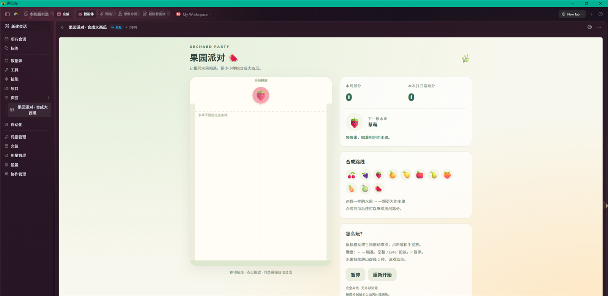
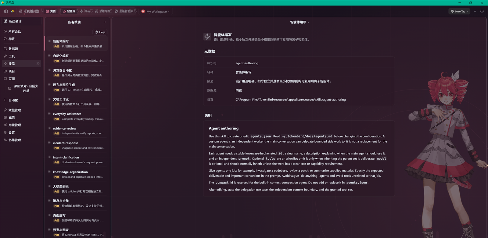

# TokenBird · 词元鸟

**把模型、工具、文件和智能体团队放进同一个工作台。**

TokenBird 是开源的智能体插件宿主与统一工作台。它不仅用于聊天，还能让智能体操作真实文件、连接外部服务、浏览网页、编辑图片，并把结果保存为文档、交互页面或可复核的项目产物。

你可以在一个工作区里并行处理多个会话，也可以组织超级智能体团队分工执行任务；在本机工作，或通过桌面端、Web、移动端和 CLI 连接远程执行服务。

[](LICENSE)

[快速开始](#快速开始) · [视频教程](#视频教程) · [功能概览](#功能概览) · [开发与构建](#开发与构建) · [文档](#文档)

> 本文依据当前仓库代码与实际桌面界面整理。不同平台、模型连接和智能体后端提供的能力不同；工具是否可用，以当前会话和设置页面为准。

## 视频教程

**[在 Bilibili 观看：TokenBird 入门教程｜一句话制作合成大西瓜小游戏，从配置到试玩](https://www.bilibili.com/video/BV1Wjpz65Efw)**

从一个具体的小项目开始了解词元鸟。下面是当前应用中的合成大西瓜成果页：智能体生成的交互内容可以留在 Pages 中，继续查看和修改。

[](https://www.bilibili.com/video/BV1Wjpz65Efw)

*实际桌面截图；点击图片打开视频。*

## 你可以用它做什么？

| 场景 | 从一句话开始 | 工作台里的结果 |
| --- | --- | --- |
| 编程与项目开发 | “查看这个仓库，定位问题并补上测试。” | 文件修改、命令回执、代码 diff 与验证结果 |
| 研究与资料整理 | “比较这些方案，保留来源并整理成报告。” | 带引用的总结、表格、图表和文档 |
| 办公与数据处理 | “分析这份表格，生成汇总和演示材料。” | 数据预览、处理脚本及导出的文件 |
| 页面与小工具 | “制作一个可交互的小游戏或项目看板。” | 可重复打开、编辑和分享的 Pages |
| 图片创作与编辑 | “生成一张图片，再调整构图和局部颜色。” | 绘图会话、图层、选区与图片导出 |
| 团队分工 | “拆解这个目标，让开发和验证分别进行。” | 超级智能体的计划、任务、共享板和交付产物 |
| 持续工作 | “定时整理项目进展，有变化时通知我。” | 自动化触发的会话与消息渠道回复 |

外部服务、图片生成、模型请求和消息发送需要相应连接或配置；不是安装后就能无条件调用的免费服务。

## 功能概览

### 一个工作区，多种智能体后端

词元鸟把“工作台”与“智能体推理循环”分开：工作区、数据源、技能、权限和成果展示由宿主管理，后端保留各自的执行方式。

- 支持 **Pi、Codex、Claude Code、Hermes、DeepSeek Harness（DSH）**，可在后端设置中安装、配置和验证。
- AI 连接支持 TokenNest、API Key、订阅账号以及兼容接口；具体认证与模型范围取决于连接类型。
- 按全局、工作区或会话选择模型与思考级别；切换后端时安全重建运行时。
- 可导入、导出用户偏好和指令，也可通过桥接协议扩展后端。

**模型连接不等于后端框架。** 同一模型在不同后端中的工具、流中引导、上下文管理与历史恢复能力可能不同；切换后端不代表迁移全部原生隐藏状态。

详见 [后端接入指南](docs/agent-plugins/README.md) 与 [框架能力说明](docs/agent-plugins/framework-capabilities.md)。

### 会话、项目与任务组织

- 多会话并行，独立保存消息、附件、模型、权限和工作目录。
- 用项目、状态、标签、置顶和归档组织长期工作；支持列表与看板视图。
- 多标签、多面板与独立窗口，适合边看对话边检查网页或成果。
- 实时展示文本、思考和工具活动，支持代码高亮、数学公式、Mermaid、表格与多文件 diff。
- 任务看板可把工作保存为待办；**创建任务不等于已经开始执行**，启动与最终关闭由用户或配置的自动化决定。

### 数据源、技能与自定义智能体

通过 **Sources** 把真实信息接入智能体：

- **MCP**：远程 HTTP / SSE 服务或本地 stdio 进程。
- **REST API**：自定义接口、认证方式和请求范围。
- **本地目录**：代码仓库、知识库、资料目录等。
- **OAuth 集成**：为支持的 Google、Slack、Microsoft 等服务完成认证。

通过 **Skills** 把操作经验沉淀成可复用流程；通过自定义智能体限定角色职责与工具范围。内置技能覆盖开发、验证、研究、文档、浏览器、Pages、绘图、远程操作等场景，按需读取而不是全部塞进每轮提示词。

支持导入 MCP 配置，以及将来源、技能和自动化打包迁移；资源包会剥离密钥，接收端仍需重新认证。



*当前桌面端的技能管理界面，展示自定义主题；截图已裁去底部账户区域和系统桌面。*

### 浏览器、文件与桌面操作

- 读取、搜索、创建和编辑文件，在允许的范围内执行命令。
- 附加图片、PDF 和 Office 文档，提取内容并生成成果文件；解析效果取决于文件格式与平台工具链。
- 内置受控浏览器支持导航、页面结构读取、点击、填写、截图、下载及网络诊断。
- Windows 桌面控制支持窗口观察、UI Automation、鼠标与键盘操作；不能绕过锁屏、UAC 或应用权限。
- 已保存凭据通过安全输入流程管理，不需要把密码粘贴到聊天中。

桌面操作控制的是**执行宿主的可见桌面**，并非自动获得远程客户端的桌面权限。详见 [Windows 桌面控制](docs/windows-computer-use.md)。

### Pages：把聊天结果变成长期成果

Pages 是保存在工作区中的 HTML 页面，适合报告、交互说明、小工具和仪表盘。

- 静态页、交互页和接收数据更新的 live 页。
- KV 数据和数值时间序列存储，可配合定时刷新脚本。
- 在应用内持续查看和修改，也可配置密码保护的公开分享。
- 页面在隔离环境中渲染；独立页面应内联资源，分享副本不依赖外部网络加载。

### 绘图与视觉工作台

- 图层、分组、透明背景、画布尺寸、选区与遮罩。
- 画笔、橡皮、文字、形状、渐变，以及变换、裁剪和对齐。
- 色彩调整、滤镜、像素化、曝光笔、克隆和修复等局部编辑工具。
- 通过配置的图片连接进行生成、局部重绘、扩图与透明主体生成。
- 支持项目保存和 PNG / JPEG / WebP 导出；另有思维导图编辑入口。

详见 [画布修图功能](docs/canvas-retouch.md)。AI 图片能力取决于所选模型与连接，图像生成通常单独计费。

### 超级智能体：分工、执行与复核

超级智能体不是把多个模型回复简单拼在一起，而是把一个目标变成有状态的团队工作：

1. **意图主节点**理解目标、澄清问题并向用户交付。
2. **编排节点**维护计划、任务依赖、资源分配和验收。
3. **工作节点**在各自的持久会话中执行、登记产物并提交证据。

可以从日常助手、自主代码、自主科研、高效工作、故障运维等预设开始，再配置节点、模型、技能、来源和执行环境。界面提供聊天、进展、节点活动、共享板、产物、脚本、历史与知识库入口。

- 支持依赖调度、并发限额和资源互斥。
- 使用检查点、操作回执与文件指纹保存进度；未知执行结果需要核验，不能盲目重试。
- 可以安排另一工作节点独立复核，**任务提交、审核通过和目标交付是不同状态**。
- 持续工作与恢复围绕已授权目标进行，不保证外部系统的 exactly-once 执行。

运行由 TokenBird 服务结合 Microsoft Agent Framework 工作流桥接完成；执行宿主需准备相应 Python 运行时与固定依赖。请先阅读 [使用指南](docs/super-agent.md)、[运行时说明](docs/super-agent/microsoft-agent-framework.md) 和 [权限与行动门](docs/super-agent/action-gates.md)。

### 自动化、消息与个性化

- 按标签变化、会话事件、计划时间等触发自动化，支持提示动作、Webhook、条件、限流和重试。
- 可配置 Telegram、WhatsApp、飞书 / Lark、企业微信等消息渠道；附件和卡片支持依平台而异。
- 提供主题、工作区外观覆盖、输入偏好、快捷键与桌面小鸟伴侣。
- 设置中集中管理 AI、后端、工具、权限、消息、远程服务器、性能和本地功能指南。

## 快速开始

### 安装桌面应用

macOS / Linux：

```bash
curl -fsSL https://openai.goldgom.top/tokenbird/install-app.sh | bash
```

Windows PowerShell：

```powershell
irm https://openai.goldgom.top/tokenbird/install-app.ps1 | iex
```

也可查看 [GitCode 发布页](https://gitcode.com/Goldgom/token-bird/releases)。只下载与你的平台、架构相符的产物。

> 上述命令会下载并执行安装脚本。请先确认域名和脚本内容可信；也可以先保存脚本、检查后再运行。模型服务费用由所选供应商或账户收取。

### 第一次使用

1. 启动词元鸟，创建或选择工作区。
2. 在 **设置 → AI** 添加模型连接，选择可用模型；需要时在后端设置中准备对应运行时。
3. 创建会话，选择工作目录与权限模式。初次操作真实项目时，建议先使用“探索”或“请求编辑”。
4. 用一句话描述目标；需要外部资料时再启用来源，需要固定流程时再添加技能。
5. 检查工具回执与成果预览，确认结果后保存、导出或分享。

不需要先配置全部功能。一个模型连接和一个会话就可以开始。

## 平台与部署

| 入口 | 用途与边界 |
| --- | --- |
| Windows / macOS / Linux 桌面端 | Electron 工作台、本地文件和系统集成；系统相关工具因平台而异 |
| WebUI | 在浏览器中连接执行服务；本机能力以服务端和客户端桥接实际提供的范围为准 |
| Android | 仓库提供客户端及打包工程；设备权限须通过系统授权 |
| iPhone / iPad | SwiftUI / WKWebView 远程客户端；构建和安装需要相应 Apple 工具链或签名 |
| 无头服务器 | 在常驻主机运行会话与工具，供桌面、Web 和 CLI 连接 |
| CLI | 终端运行、会话管理与脚本化调用 |
| 云服务器 / 中继 | 远程连接与设备通信设施，不等同于执行宿主 |

仓库提供移动端源码与构建脚本，不表示所有平台都已上架应用商店。各端构建方式见 [编译指南](docs/build-guide.md) 和 [iPhone / iPad 说明](apps/ios/README.md)。

### 远程服务

以下为 Bash 示例，从仓库根目录运行：

```bash
bun install
bun run server:build:subprocess
export TOKENBIRD_SERVER_TOKEN="$(openssl rand -hex 32)"
export TOKENBIRD_RPC_HOST=0.0.0.0
bun run server:start
```

默认 RPC 端口为 `9100`。公开监听前先配置防火墙与访问范围；公网连接应使用 TLS（`wss://`）或可信反向代理，不要暴露无保护的服务。

WebUI 的完整生产构建可使用 `bun run server:prod`（Bash 环境）。Docker、TLS、WebUI 和运行时资源的具体准备见 [编译与部署指南](docs/build-guide.md)；云中继见 [云服务器说明](docs/cloud-server.md)。

### CLI

```bash
# 自包含运行：自动启动本地服务并输出结果
bun run apps/cli/src/index.ts run "总结当前仓库的结构"

# 查看完整命令
bun run apps/cli/src/index.ts --help
```

连接已有服务时设置 `TOKENBIRD_SERVER_URL` 和 `TOKENBIRD_SERVER_TOKEN`；CLI 精简发行版可用 `bun run cli:build` 构建。详见 [CLI 文档](docs/cli.md)。

## 权限与安全

| 模式 | 适合的工作方式 |
| --- | --- |
| 探索（Explore） | 先读取、搜索和制定方案；计划与任务数据目录存在受控写入例外，并非 OS 级只读沙箱 |
| 请求编辑（Ask to Edit） | 在需要修改或有副作用的操作前请求确认，适合日常协作 |
| 执行（Execute） | 在当前权限与配置边界内自主执行，适合明确且可信的任务 |

- **工作目录不是安全沙箱**。执行权限、第三方插件和外部工具都需要按最小范围配置。
- 超级智能体的 **完全控制** 是独立的高权限开关，默认开启；使用前核对执行环境与可访问资源。关闭后也不能把一次审批当作永久授权。
- 凭据由宿主安全存储与认证流程管理；工作区配置隔离不等于操作系统级隔离。
- 不要提交 `.env`、令牌、OAuth 密钥、日志中的秘密或未经检查的会话附件。
- 分享 Pages、对话和截图前，检查个人信息、内部路径与机密内容。
- 插件与 MCP 服务可以执行真实操作，只安装可信来源；Docker / Podman 隔离需要实际配置，虚拟机模式不会自动创建虚拟机。

开发配置模板见 [`.env.example`](.env.example)，漏洞报告方式见 [SECURITY.md](SECURITY.md)。

## 开发与构建

基础环境：**Bun 1.3.x、Node.js 18+、npm 和 Git**。桌面打包、移动端及部分文档工具还需要平台专属依赖，详见编译指南。

```bash
git clone https://github.com/Goldgom/craft-agents-oss.git TokenBird
cd TokenBird
bun install
bun run electron:dev
```

国内镜像：[GitCode / Goldgom / token-bird](https://gitcode.com/Goldgom/token-bird)。仓库地址保留历史名称，应用品牌为 TokenBird / 词元鸟。

| 命令 | 作用 |
| --- | --- |
| `bun run electron:dev` | 桌面开发模式 |
| `bun run electron:start` | 构建并启动桌面端 |
| `bun run webui:build` | 构建浏览器工作台 |
| `bun run server:start` | 启动无头服务，需准备认证和运行时资源 |
| `bun run build:all win linux android --release` | 按当前环境构建指定发行目标 |
| `bun run ios:prepare` | 准备 iOS 前端资源 |
| `bun run ios:build:simulator` | 在 macOS / Xcode 环境构建模拟器客户端 |
| `bun run typecheck:all` | 全量类型检查 |
| `bun run test` | 仓库测试及独立测试脚本；脚本使用 POSIX shell，Windows 可使用 Git Bash / WSL |

开发服务器和部分部署脚本同样使用 POSIX 语法。跨平台构建不能替代目标平台的运行验证；不要直接套用当前主机无法支持的签名或打包命令。

### 项目结构

```text
apps/
  electron/            桌面端与随应用打包的资源、文档和技能
  webui/               浏览器工作台
  android/             Android 客户端
  ios/                 iPhone / iPad 客户端
  cli/                 命令行客户端
  viewer/              会话分享查看器
packages/
  core/                核心类型与基础逻辑
  shared/              模型、认证、来源、技能和共享业务逻辑
  server-core/         会话执行、RPC、超级智能体与可复用服务
  server/              Bun 无头执行服务
  cloud-server/        云中继服务
  session-tools-core/  会话工具定义与处理
  pi-agent-server/     Pi 运行时服务
  ui/                  共享 React UI 组件
  messaging-*/         消息平台适配
```

## 文档

| 文档 | 内容 |
| --- | --- |
| [本地功能指南](apps/electron/resources/docs/product-guide.md) | 会话、来源、技能、工具、页面及设置入口 |
| [编译指南](docs/build-guide.md) | 桌面、移动、无头服务与部署 |
| [CLI 参考](docs/cli.md) | 终端运行与管理命令 |
| [智能体插件接入](docs/agent-plugins/README.md) | 后端安装、桥接协议与偏好迁移 |
| [框架能力说明](docs/agent-plugins/framework-capabilities.md) | 不同后端的真实支持与限制 |
| [超级智能体使用指南](docs/super-agent.md) | 团队配置、使用与故障排查 |
| [超级智能体设计文档](docs/super-agent/README.md) | 编排、检查点、权限、验收与恢复机制 |
| [Pages 文档](apps/electron/resources/docs/pages.md) | 页面格式、数据桥接和分享 |
| [画布修图](docs/canvas-retouch.md) | 图片编辑工具与边界 |
| [Windows 桌面控制](docs/windows-computer-use.md) | 可见桌面操作、安全与截图 |
| [小鸟伴侣](docs/bird-companion.md) | 桌面伴侣与进度反馈 |
| [云服务器](docs/cloud-server.md) | 中继架构、部署与客户端连接 |

应用内也可通过 **设置 → 功能指南** 阅读随安装包提供的离线文档。

## 贡献与许可

欢迎报告问题、改进代码和补充文档。参与前请阅读 [CONTRIBUTING.md](CONTRIBUTING.md) 与 [CODE_OF_CONDUCT.md](CODE_OF_CONDUCT.md)。

TokenBird 基于 Craft Agents 开源项目演进，保留上游及第三方的版权和许可声明；详见 [NOTICE](NOTICE)。代码以 [Apache License 2.0](LICENSE) 发布，品牌使用规则见 [TRADEMARK.md](TRADEMARK.md)。
