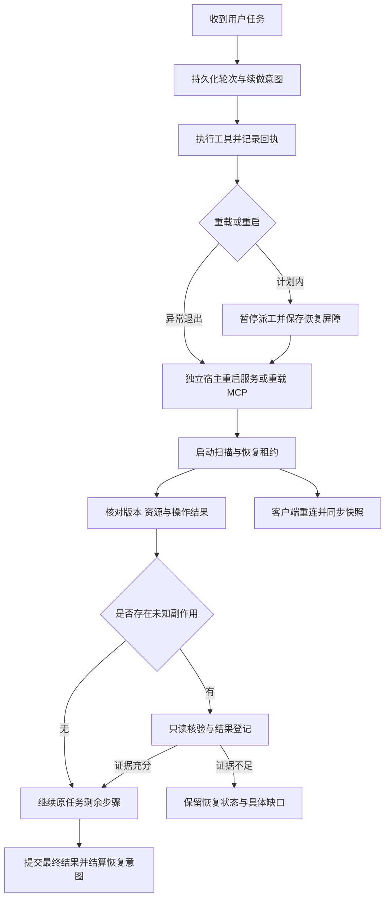

# 服务重启与运行时重载后的自动续做设计

状态：设计方案，尚未接入运行时。适用于普通聊天、超级智能体、MCP 重载、服务更新和异常退出。

目标：用户无需点击 Retry，服务恢复可用后自动回到原任务，保留已完成成果，从可验证的位置继续。恢复由宿主完成，不依赖客户端在线或模型在重启前主动保存检查点。完全控制开关不决定是否恢复；续做采用当前权限。

## 现有链路与缺口

本方案基于当前代码核对；截图中的 `[binance-cli-mcp activated]` 能证明发生了源激活，不能单独证明整个 TokenBird 服务重启。供应商 503、MCP 子进程退出和宿主重启必须分开记录。

| 位置 | 当前行为 | 需要补齐 |
| --- | --- | --- |
| `packages/server-core/src/transport/client.ts` | 有退避重连、序号和 stale reconnect；收到 `server:shuttingDown` 时设置 `permanentlyClosed` | 区分重启与永久关闭；可恢复关闭不能禁止重连 |
| `packages/server-core/src/bootstrap/headless-start.ts` | 关闭前统一广播 `reason: shutdown` | 传播关闭意图、重启 ID、旧启动实例 ID，并先持久化恢复状态 |
| `packages/server-core/src/handlers/rpc/server.ts` | 重启请求保存在内存，等待全部活动会话结束 | 重启请求持久化；支持发起者到达安全暂停点，避免等待自己的轮次结束形成循环等待 |
| `packages/server-core/src/sessions/SessionManager.ts` | 恢复排队消息；源激活依赖内存中的 `autoRetryPending` 和 100ms timer 续做，cleanup 会清除它们 | 持久化执行中的轮次与待续做意图，覆盖 timer 创建前后和服务退出窗口 |
| `packages/server-core/src/super-agent/SuperAgentService.ts` | 中断轮次置失败；有检查点且满足条件的任务可续做；未知副作用已有核验机制 | 没有模型检查点也能从宿主执行记录恢复；重启恢复与 continuousWork 分离，复用已有操作核验机制 |
| `apps/electron/src/renderer/App.tsx` | stale reconnect 会刷新会话 | 统一展示恢复阶段；客户端只同步状态，不能另起一次续做 |

既有的检查点、操作指纹、操作核验、最终持久化和客户端刷新机制应继续使用，避免再建立一套互相竞争的超级智能体调度器。

## 总体流程

恢复的是原任务及其进度。旧模型进程、流式连接和调用栈可以被替换；工具是否完成以持久回执和真实状态核验为准。

## 持久化契约

引入统一的 `RecoveryCoordinator`，提供普通会话和超级智能体两个适配器。超级智能体仍由原调度器派工；协调器只决定哪些轮次需要恢复及恢复屏障是否已解除。

建议数据分成宿主级 `recovery/host.json` 与工作区级 `recovery/runs/<runId>.json`。使用带修订号的原子提交、同盘 rename 和必要的 fsync；串行化每个 run 的写入。源激活事件、待续做记录及对应 transcript revision 必须处于同一个提交，或通过可重放的提交记录保证一致性，不能依赖两个独立文件恰好同时写完。

| 字段 | 用途 |
| --- | --- |
| `schemaVersion`, `revision` | 迁移、并发更新与损坏检测 |
| `runId`, `workspaceId`, `sessionId`, `userMessageId` | 原任务身份；不依赖原始请求文本去重 |
| `taskId`, `turnId`, `checkpointRevision` | 超级智能体原任务与阶段引用 |
| `hostInstanceId`, `generation` | 每次服务启动生成新实例 ID；阻止旧回调和旧进程结算新尝试 |
| `trigger`, `restartId`, `targetVersion` | 区分服务重启、MCP 重载、源激活和传输故障 |
| `phase`, `resumeReason`, `lastCommittedMessageId` | 当前恢复阶段及继续所需的原始记录引用 |
| `operationIds`, `sourceSlugs`, `artifactRefs` | 引用既有回执、资源和产物，不复制敏感原参数 |
| `attempt`, `nextAttemptAt`, `deadline`, `lastErrorCode` | 持久化退避、故障分类和有界自动重试 |
| `owner`, `leaseExpiresAt`, `fencingToken` | 唯一恢复执行者及过期接管 |
| `cancelRevision`, `supersededByMessageId` | 用户停止、新要求和旧任务恢复之间的顺序 |

记录不得持久化 API key、环境变量内容或重复的工具秘密参数。原请求、附件和工具回执通过已有会话存储引用，检查权限与归属后读取。

状态建议为 `running → suspending → waiting-runtime → reconciling → resuming → running/completed`。异常退出后由启动扫描把上一个实例遗留的非终态转为 `reconciling`。`cancelled` 为终态；暂时故障进入 `retry-wait`，证据或用户信息不足进入 `blocked`，明确不兼容进入 `failed`，保留具体原因。

租约必须依赖真正的跨进程互斥/事务，不能只用内存 Map 或无锁 JSON 覆盖。第一版限定同一状态目录只运行一个调度宿主，恢复器持有宿主独占锁，并用 generation 拒绝迟到回调。多实例版本需采用事务数据库和原子租约。fencingToken 只有在执行入口校验时才能阻止重复派发，不能撤销已经发送到外部系统的操作。

## 计划内自更新与重启

1. AI 修改候选版本并完成必要检查；记录目标版本/文件哈希，保留已知可用版本。MCP 配置变更优先只重载对应数据源，避免整机服务重启。
2. AI 使用宿主维护入口提交重启请求。入口先持久化 `restartId` 和关联 run，返回“请求已登记”的回执。模型不在同一个 shell 调用中等待自己的服务先退出再返回。
3. 宿主进入 draining，拒绝新的执行派工；现有轮次完成或到达可暂停点。发起者在维护回执持久化后挂起，其他长任务按明确的 drain 超时处理，不能无限等所有模型自然结束。
4. 写入宿主恢复屏障：最后提交的会话修订、待恢复轮次、已知操作和未结算调用。flush 成功后广播重启通知，再退出。flush 失败则取消计划内重启并保留旧实例，不假报“已准备恢复”。
5. systemd 或独立维护进程负责启动新版本。维护进程位于被重启服务的 cgroup 之外，其状态不能依赖 AI 子进程存活。
6. 新实例先获得宿主锁，校验存储版本并恢复基础资源；对外分别报告 liveness、readiness 和恢复进度。随后进入核验和原任务续做。
7. 独立维护进程检查进程、目标版本及认证 RPC 就绪。更新后启动失败时回退已知可用版本并再次验证；不兼容存储迁移必须有兼容读取或单独的迁移回退方案，不能只回退二进制。

直接从 Bash 执行 `systemctl restart`、进程被杀或断电可能绕过维护入口。它们仍由每轮开始前和每次副作用派发前的持久化记录兜底，但不能保证保留尚未提交的输出。不要通过匹配 shell 字符串来证明重启已完成。

## 启动后的核验与续做

1. 扫描所有已登记的非终态 run，不等用户打开聊天页或工作区。恢复器不得因为 continuousWork 关闭而漏掉已授权但被重启中断的轮次。
2. 检查用户停止/取消、任务版本及最新消息；显式停止绝不唤醒，目标变化后让原调度器按新契约处理。将服务维护中断与用户停止分成不同事件原因。
3. 认领恢复租约并核对原 transcript、任务检查点、工具回执及进程身份。缺少模型检查点时使用宿主持久化的原请求和已结算回执，不能直接认定失败或重新执行整段请求。
4. 校验运行目录、后端配置、技能和数据源。仅对需要的源重建连接与工具目录；密钥缺失保留具体认证请求。恢复沿用当前权限，不继承已失效的一次性审批，不因完全控制关闭而拒绝恢复流程本身。
5. 按下面的操作表核验，必要时复用现有超级智能体独立证据任务与 `reconcile`。普通聊天也必须拥有同样的操作回执和核验入口。
6. 在唯一执行入口提交一个新 attempt，关联原 run。重用可恢复的提供商会话；提供商历史损坏或无法补齐工具结果时，建立新的模型上下文，保留原会话记录和关联，不伪造 tool_result。
7. 隐藏上下文提供原目标、完成步骤、已核验结果、未知项、资源变化与下一步。可见聊天保留原请求，追加一条恢复状态；不再插入一条重复的用户任务。
8. 在最终答复和任务结果持久化后结算 run。恢复模型已启动、客户端已重连或工具目录已加载都不能当作任务完成。

| 中断位置 | 恢复处理 |
| --- | --- |
| 尚未派发的只读调用 | 新 attempt 可直接执行 |
| 派发中的只读调用 | 重建资源后可有界重试；旧连接返回由 generation 校验拒绝 |
| 已完成的写入/交易/发送 | 读取回执继续后续步骤，禁止重放 |
| 已登记但不确定是否派发的写入 | 保守标记未知；只有真实证据证明未执行后才重试 |
| 文件修改返回丢失 | 核对目标内容/哈希和预期变更；不重复套补丁，不覆盖重启后的新改动 |
| MCP 请求返回丢失 | 使用服务端请求 ID、业务幂等键或只读查询核验；进程启动成功不代表请求成功 |
| 重启调用的返回丢失 | 核对 restartId、新实例 ID、目标版本与健康回执，不再次执行重启 |
| 长计算/脚本存活未知 | 通过受管任务 ID、PID 启动时间及执行宿主确认身份；不得只凭 PID 或安静时长重启 |
| 部分助手文本已输出 | 保留已提交内容并补充后续答案，不承诺逐 token 接续 |

外部系统没有幂等键或结果查询能力时，无法同时保证任意中断后自动重试和副作用恰好一次。此时系统应自动调查并明确保留未知结果；只有确实需要用户信息或业务决定时才请求介入。

## MCP 源激活的专门处理

将 `source_activated` 的 100ms timer 替换为持久化 continuation。源激活提交成功后记录 `runId + sourceSlug + sourceRevision`，由宿主等待旧 attempt 释放、确认新工具目录 ready，再启动一次续做。timer 只负责唤醒调度器，不承担记录本身。

正常运行、进程在 timer 前后退出、多个源连续激活、旧客户端重复 auto_retry 都消费同一条 continuation。通过稳定 ID 和原子认领去重，不能只用请求内容和几秒钟的内存 deadline。旧客户端兼容 RPC 映射到已有 continuation；无法确定归属时不得新建一轮重复任务。

源重载成功后模型供应商返回 503，归类为 provider transient，保留 continuation 与已验证进展并退避；不能因此再次重载源或再次执行先前修改。

## 连接与界面

关闭协议增加 `reason: restart | shutdown`、`restartId`、`hostInstanceId` 和 `retryAfterMs`。`retryAfterMs` 是退避建议，不是可用性证明。计划重启继续重连；SIGTERM 无法区分运维重启和永久停机时也保留退避重连，只有客户端明确断开、服务配置删除或认证失效才终止自动尝试。最终协议需明确兼容旧客户端：旧客户端可能仍需手动重新连接，不能声称升级服务器即可修复已打包旧客户端的永久关闭逻辑。

握手增加新 `hostInstanceId`。实例改变或事件序号缺口无法补齐时，拉取带 revision 的会话、恢复和任务快照；先建立订阅再按快照水位应用后续事件，避免快照加载期间漏事件。现有内存事件缓存不能作为跨重启恢复依据。

普通断线时客户端查询稳定 runId 的受理状态，不能盲目重放超时的写 RPC。客户端从来不决定恢复任务或重新发送用户请求，所有设备共享宿主的恢复状态。

界面展示“服务正在重启 → 正在恢复连接 → 正在核验执行结果 → 已继续任务”。供应商暂时不可用展示下一次自动重试时间。真正需要用户处理时展示具体原因与操作；保留手动重试入口，但它只唤醒同一恢复记录，不创建重复执行。用户停止按钮需先持久化取消版本，再撤销未启动 attempt；派发前再次检查取消版本。

建议默认值：连接重试带抖动、上限 30 秒；单次计划重启就绪检查预算 120 秒，失败通知独立维护进程处理回退；模型或 MCP 暂时错误最多在 10 分钟内自动尝试 5 次。预算跨重启持久化，只有可验证进展或明确用户继续才重置；认证错误、版本不兼容不做无意义快速循环。超时后保留恢复记录与诊断状态，不静默丢任务。

## 实施顺序与验收

1. 先接入统一 run/continuation 持久化、启动扫描和单宿主互斥，覆盖普通聊天与超级智能体。持久化迁移保留旧会话；无执行证据的历史失败任务不能批量猜测并重放。
2. 改造源激活续做与操作回执，覆盖最常见的 MCP 更新场景，保证无需 Electron 在线。
3. 接入维护入口、恢复屏障、独立健康检查与回退，改造关闭协议和客户端快照同步。
4. 最后启用自动续做，先测试工作区演练，再在 Debian 验证；保留一键关闭自动派发的配置，关闭时仍保存回执和恢复记录。

必须验证真实进程重启，不能只测试 reconnect callback。自动化使用假模型与可计数的工具服务，在每个持久化边界注入退出：

- 源激活记录提交前后、旧 attempt 结束前后、续做认领后、模型启动前后均重启；最终同一 run 只得到一次结算。
- 修改文件成功后丢失返回，恢复核验文件并继续；重复修改计数必须为零。
- 外部写入成功后丢失返回，按业务键查询并登记；外部实际调用只能发生一次。无法核验时维持未知，不伪报成功。
- 普通聊天没有模型检查点、超级智能体关闭 continuousWork，重启后仍恢复同一已授权工作。
- 客户端关闭时宿主自行恢复；客户端重开、多设备重连和旧 auto_retry 不增加模型派工数。
- 恢复中再次重启，保留 attempt 预算与进度；旧实例回调不能覆盖新实例结果。
- 重启通知到达、通知丢失、SIGKILL、systemd restart、MCP 子进程退出、供应商 503 分别测试。
- 用户停止、用户新消息、任务取消、权限变更与恢复认领并发时，取消/新契约生效，不恢复过时任务。
- 候选版本启动失败时独立维护进程回退；状态迁移不兼容时明确失败，不破坏原记录。
- 磁盘满、fsync/rename 失败、损坏记录、宿主锁冲突、认证失效时返回可定位原因；计划内重启不能越过未持久化屏障。

Debian 演练使用隔离工作区与假副作用端点，不触碰实际交易。验收同时核对原 runId、模型 attempt 数、实际工具执行次数、文件哈希、新实例 ID、认证 RPC、任务最终结果和停止后未被唤醒，不能仅以 `systemctl active` 判定成功。
